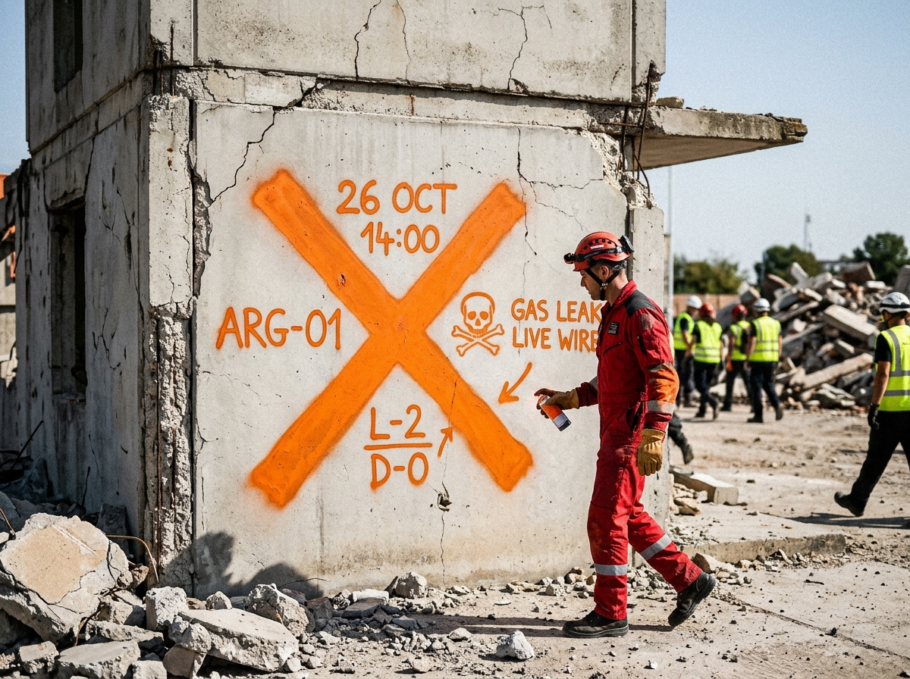
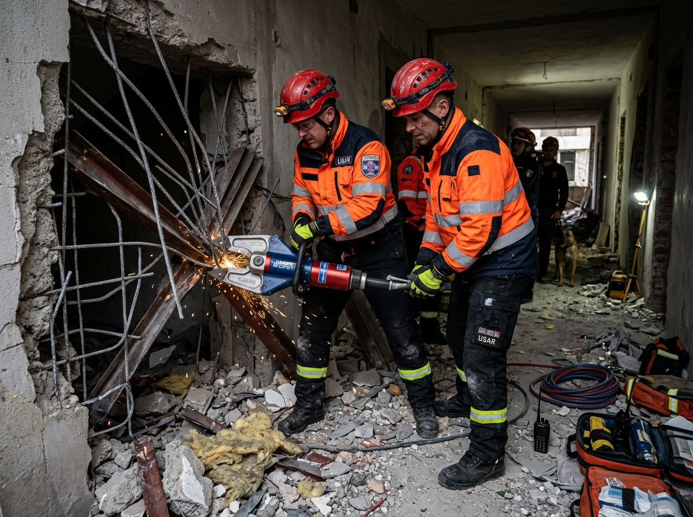
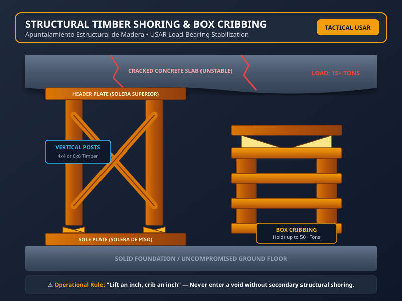
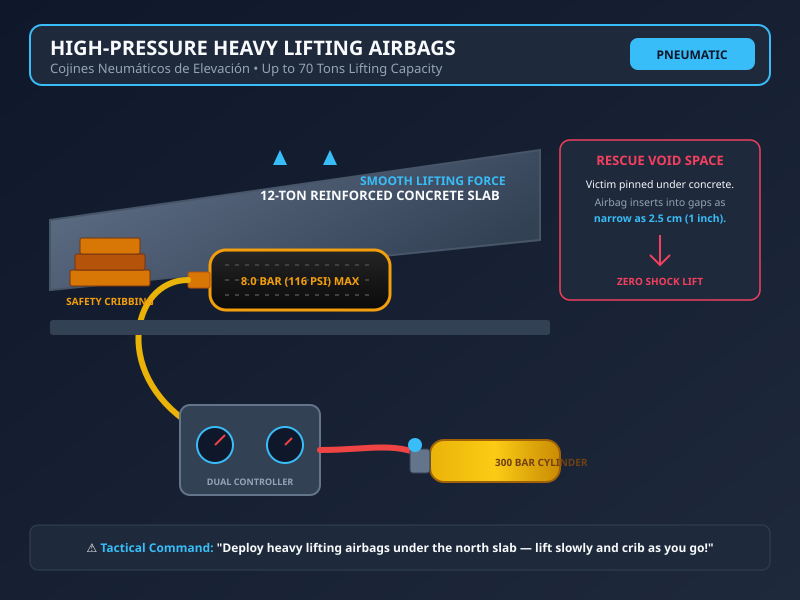
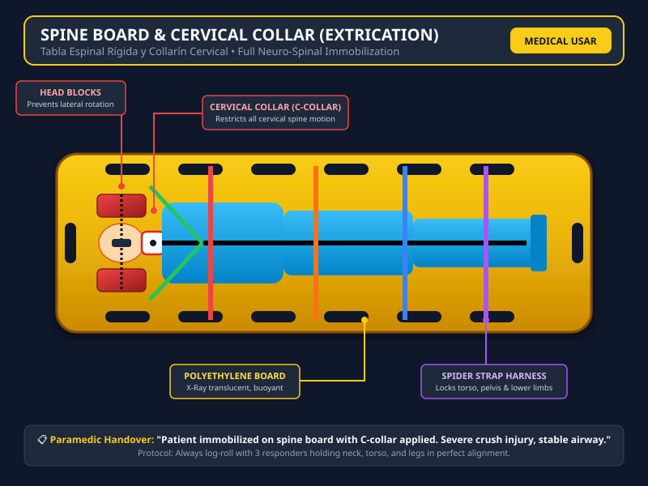
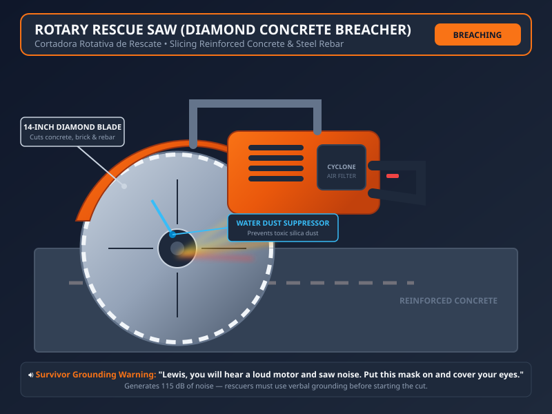
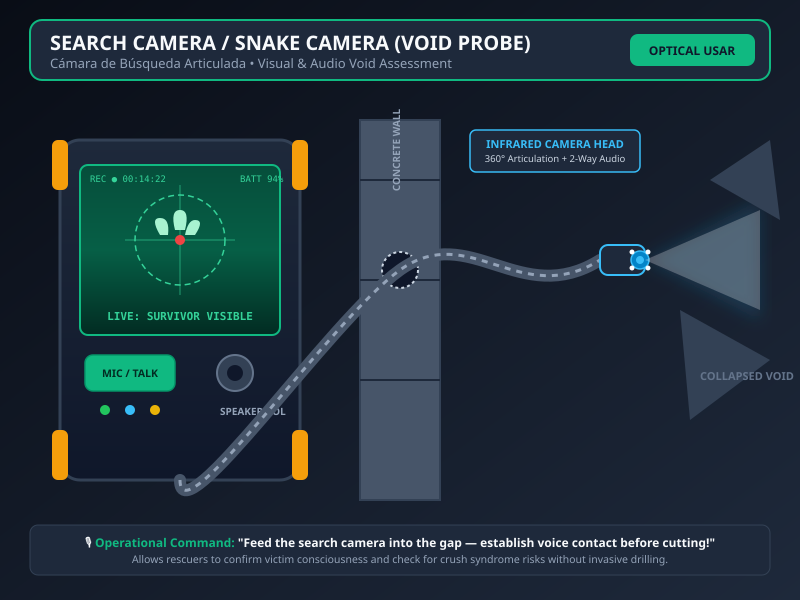

# 🖼️ Lesson 4: Visual Vocabulary & Tactical Equipment Guide
## Guía Visual de Vocabulario Táctico y Equipamiento USAR

**Target Learner:** Bernie (Humanitarian Aid & Disaster Relief Coordinator, Argentina 🇦🇷)  
**Lesson Reference:** [`lesson-04-heavy-rescue-structural-markings-extrication.md`](./lesson-04-heavy-rescue-structural-markings-extrication.md)

---

### 1. 📐 INSARAG / FEMA Structural Search Marking
**Español:** Marcación Estructural de Búsqueda y Rescate (Cruz 2×2m de INSARAG)  
**Pronunciation:** `/ˈstrʌk.tʃər.əl sɜːtʃ ˈmɑːk.ɪŋ/` (*STRÁK-cher-al SERCH MAR-king*)



#### 📖 Operational Description for Louie:
* **What it is:** A standardized 2-meter by 2-meter orange or yellow spray-painted "X" placed beside the main entry point of any collapsed structure during international urban search and rescue (USAR) operations.
* **Why Bernie needs it:** When international teams (from the UN, UK, USA, or France) enter Bernie’s operational sector, they communicate building safety and victim locations exclusively through this cross.
* **The 4 Quadrants:**
  * **TOP (Date & Time):** The exact date and military time the search team entered and exited (e.g., `26 OCT 14:00 IN / 17:15 OUT`).
  * **LEFT (Team Identifier):** The international or national callsign of the search squad (e.g., `ARG-01` for Argentina Team 1).
  * **RIGHT (Hazards Identified):** Critical ground-zero dangers found inside (e.g., `GAS LEAK`, `LIVE WIRES`, `SECONDARY COLLAPSE RISK`).
  * **BOTTOM (Victims Extricated):** Number of live victims (*L*) and deceased persons (*D*) retrieved from that specific structure (e.g., `L-2 / D-0`).
* **Key Phrases for Bernie:**
  * *"The structure is marked as searched."*
  * *"Hazards identified: confirmed gas leak and live power lines."*
  * *"Two live victims extricated, zero deceased."*

---

### 2. ✂️ Hydraulic Cutters & Spreaders ("Jaws of Life")
**Español:** Tijeras de Corte y Expansores Hidráulicos ("Quijadas de la Vida")  
**Pronunciation:** `/haɪˈdrɒl.ɪk ˈkʌt.ərz ənd ˈspred.ərz/` (*hai-DRÓ-lik KÁ-ters and SPRÉ-ders*)



#### 📖 Operational Description for Louie:
* **What it is:** High-pressure hydraulic extrication tools powered by petrol or electric power-packs generating up to 720 bar of pressure. 
* **Tactical Function:**
  * **Cutters:** Slice through high-strength vehicle frames, thick reinforced steel rebar (*rebar*), and structural metal piping.
  * **Spreaders:** Insert closed into a tight seam and open outward with several tons of spreading force to pry apart collapsed concrete slabs, vehicle doors, or jammed metal security gates.
* **Operational Nuance:** These tools are extremely heavy (15–25 kg each), require hydraulic hoses or battery packs, and generate loud humming engine sounds and metallic snapping noises that can alarm trapped victims.
* **Key Phrases for Bernie:**
  * *"Requesting heavy rescue with hydraulic cutters and spreaders!"*
  * *"We need to cut the rebar framework to open the rescue void."*
  * *(To trapped victim):* *"You will hear loud cutting noises. Stay calm, we are cutting through the metal."*

---

### 3. 🪵 Structural Timber Shoring & Cribbing
**Español:** Apuntalamiento Estructural de Madera / Cunas de Soporte  
**Pronunciation:** `/ˈstrʌk.tʃər.əl ˈtɪm.bər ˈʃɔː.rɪŋ/` (*STRÁK-cher-al TÍM-ber SHÓ-ring*)



```
             =================================  <-- Compromised Concrete Ceiling
                     [ Top Header Plate ]
                            |   |
                            |   |  <-- Vertical Timber Shore Posts (4x4 or 6x6)
                            |   |
                     [ Wedges / Calzos ]        <-- Adjusted for tight friction fit
             ---------------------------------
             # # # # # # # # # # # # # # # # #  <-- Box Cribbing (Wood blocks stacked like Jenga)
             =================================  <-- Stable Floor Slab
```


#### 📖 Operational Description for Louie:
* **What it is:** Temporary load-bearing wooden structures engineered by rescue squads using dimensional lumber (4×4 or 6×6 inch solid timber beams).
* **Tactical Function:** Erected inside a damaged building to brace and catch cracked ceilings, unstable arches, or leaning structural walls. It stabilizes the building so aftershocks or rescue vibrations don't trigger a secondary collapse while rescuers crawl underneath.
* **Box Cribbing:** Hardwood blocks stacked crosswise in pairs (like a giant Jenga tower) beneath heavy loads to support tens of thousands of kilograms during progressive lifting operations.
* **Key Phrases for Bernie:**
  * *"The ceiling is sagging. We need immediate timber shoring to stabilize the void."*
  * *"Do not enter until the structural engineer inspects the shoring."*
  * *"Secure the lifting point with box cribbing."*

---

### 4. 🎈 Heavy Lifting Airbags
**Español:** Cojines Neumáticos de Elevación de Alta Presión  
**Pronunciation:** `/ˈhevi ˈlɪf.tɪŋ ˈeə.bæɡz/` (*HÉ-vi LÍF-ting ÉAR-bags*)



#### 📖 Operational Description for Louie:
* **What it is:** Ultra-thin (less than 2.5 cm uninflated), reinforced Kevlar or steel-wire woven rubber pneumatic cushions connected via dual hoses to a SCBA compressed air cylinder.
* **Tactical Function:** Rescuers slide them into millimeter-thin gaps underneath collapsed slabs where mechanical jacks cannot fit. When inflated, they exert up to 70 tons of smooth, controlled lifting force without jerky movements that could cause concrete to crumble over victims.
* **Operational Rule:** As the bag lifts, rescuers immediately insert wooden cribbing beneath the load (*"Lift an inch, crib an inch"*).
* **Key Phrases for Bernie:**
  * *"The slab is pinning the survivor's legs. Deploy heavy lifting airbags."*
  * *"Insert the airbag into the void and connect the regulator."*
  * *"Lift slowly. Pack wooden wedges underneath."*

---

### 5. 🛏️ Spine Board (Backboard) & Cervical Collar (C-Collar)
**Español:** Tabla Espinal Rígida y Collarín Cervical  
**Pronunciation:** `/spaɪn bɔːd ænd ˈsɜː.vɪ.kəl ˈkɒl.ər/` (*SPAIN BORD and SER-vi-kal KÓ-lar*)



#### 📖 Operational Description for Louie:
* **What it is:** A rigid, non-flexible high-density plastic board fitted with handholds and strap anchor points, used in tandem with an adjustable cervical neck collar and lateral head blocks.
* **Tactical Function:** Complete spinal immobilization. When a victim is extricated from confined spaces, any movement of a fractured cervical or thoracic vertebra can sever the spinal cord, causing permanent paralysis.
* **Operational Nuance:** In USAR, a rigid spine board is often loaded inside a wire-mesh **Stokes basket** (*basket stretcher*) to hoist the patient vertically out of deep voids or rubble trenches.
* **Key Phrases for Bernie:**
  * *"Maintain cervical spine control. Apply the C-collar now."*
  * *"Log-roll the patient onto the spine board on my count: one, two, three."*
  * *"Patient is secured on the backboard. Ready for transport to the triage tent."*

---

### 6. 🪚 Rotary Rescue Saw (Diamond Blade)
**Español:** Cortadora Rotativa de Rescate (Motosierra con Disco de Diamante)  
**Pronunciation:** `/ˈrəʊ.tər.i ˈres.kjuː sɔː/` (*RÓU-ta-ri RÉS-kyu SO*)



#### 📖 Operational Description for Louie:
* **What it is:** Heavy 2-stroke petrol circular cutting saws equipped with diamond-segmented composite blades designed specifically to slice through high-strength reinforced concrete slabs, masonry walls, and asphalt.
* **Tactical Function:** Used to breach entry holes into collapsed basements or roof slabs (*breaching operations*). Rescuers use water sprays to suppress toxic silica dust.
* **Key Phrases for Bernie:**
  * *"Deploy the rotary saw to breach the western slab."*
  * *"Watch out for flying sparks and concrete dust."*
  * *(To victim):* *"We are cutting a hatch above you. Put on this dust mask and cover your eyes."*

---

### 7. 📹 Search Camera / Snake Camera (Fibroscope)
**Español:** Videoscopio / Cámara de Búsqueda para Espacios Confinados  
**Pronunciation:** `/sɜːtʃ ˈkæm.rə / sneɪk ˈkæm.rə/` (*SERCH KÁ-me-ra / SNEIK KÁ-me-ra*)



#### 📖 Operational Description for Louie:
* **What it is:** A handheld monitor with an articulated, flexible waterproof probe (3 to 5 meters long) equipped with high-intensity infrared LEDs, an optical camera head, and an ultra-sensitive two-way microphone/speaker.
* **Tactical Function:** Inserted into 50mm boreholes drilled through concrete or slipped into cracks. It allows rescuers to see into pitch-black voids, check if trapped victims are conscious, and speak directly to them before cutting.
* **Key Phrases for Bernie:**
  * *"Insert the search camera into the gap under the staircase."*
  * *"I have visual contact on a survivor! Two people visible, one responsive."*
  * *(Into the camera microphone):* *"Can you hear me? We can see you on the camera!"*

